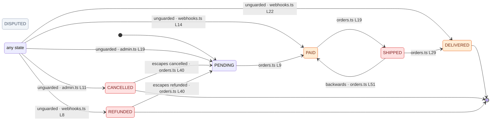

# statescope

**Point your coding agent at a codebase. Get the state machine it actually implements — drawn — and every illegal path in it, each one cited to the line that allows it.**

Your agent declared `enum OrderStatus`, then wrote `status = …` in ten places across four files. The enum constrains the column. Nothing constrains the order. So `refunded` can go back to `pending`, the admin panel can set any value it likes, and the machine in your head is not the machine you shipped.

Nobody can see this by reading the code, because the machine is not written down anywhere. statescope writes it down.



<sub>Rendered by GitHub from the Mermaid that statescope emitted — no image, no build step. Red leaves a terminal state or moves backwards. Orange is reachable with no guard at all. Grey is declared and never written. `any state` is not a state: it is what an unguarded write means.</sub>

```
  STATE AUDIT   examples/order-lifecycle/before
  1 machine · 7 states · 11 transitions · 4 files

  OrderStatus.status  (prisma_enum, schema.prisma:7)

  critical    7  ████████████████████████
  high        2  ███████
  medium      2  ███████
  low         1  ████

  12 findings across 1 machine


  CRITICAL  (7)
  ──────────────────────────────────────────────────────────
  OrderStatus · refunded -> pending
    refunded -> pending is reachable. refunded is a terminal state.
    terminal_state_escape — refunded is where a thing stops. Code downstream of
    it assumes it is settled: refunds are reconciled, invoices are closed, the
    warehouse has stopped caring. Moving it back to pending re-opens all of that
    with no record that it happened, and every report that already counted it is
    now wrong in a way nothing will flag.
      src/orders.ts:40 (guard at :37)  data: { status: "pending" },
```

The same model behind one transition table drops to **0 findings** — the full
before/after is in [`examples/order-lifecycle/`](examples/order-lifecycle).

   

---

## Install

Paste this to your agent:

```
Install statescope for me by reading
https://raw.githubusercontent.com/NHTanvir/statescope/master/llms.txt
```

Or place it yourself:

```bash
git clone https://github.com/NHTanvir/statescope ~/.claude/skills/statescope
```

Claude Code can also add it as a plugin:

```
/plugin marketplace add NHTanvir/statescope
```

Works in Claude Code, Cursor, Codex, OpenClaw and anything else that reads a
`SKILL.md`. The scripts are plain Python 3.9+ with **no dependencies**, so they
also run on their own without any agent at all.

---

## Use it without an agent

```bash
# the audit
python3 scripts/audit.py .
python3 scripts/audit.py src/orders

# the diagram, ready to paste into a README
python3 scripts/render.py . --mermaid

# one self-contained HTML file: diagram, findings, fixes, light and dark
python3 scripts/render.py . --out=state-review.html

# other shapes
python3 scripts/audit.py . --markdown     # for a PR comment
python3 scripts/audit.py . --json         # for tooling
python3 scripts/audit.py . --strict       # exit 1 on any critical, for CI
python3 scripts/audit.py . --no-fix       # findings without the fix code

# just the inferred machine, if you want to build on it
python3 scripts/extract.py .
```

Nothing phones home. No source ever leaves your machine.

---

## What it reads

The state set comes from whatever you already declared:

| Source | Example |
|---|---|
| Prisma enum | `enum OrderStatus { PENDING PAID }` |
| TypeScript union | `type JobState = 'queued' \| 'running'` |
| TypeScript enum | `enum Status { Draft = 'draft' }` |
| `as const` array | `const STATES = ['open','closed'] as const` |
| Python `Enum` | `class TicketStatus(str, Enum)` |
| PHP 8.1 enum | `enum InvoiceStatus: string { case Draft = 'draft'; }` |
| SQL `CHECK` | `CHECK (status IN ('pending','paid'))` |
| MySQL / Postgres enum | `ENUM('a','b')`, `CREATE TYPE … AS ENUM` |

The transitions come from the code: a read of the state that dominates a write
of the state is the edge between them. `if (o.status === 'paid')` above
`data: { status: 'shipped' }` is `paid -> shipped`, and the finding carries both
line numbers. A write with no such read is `* -> shipped`, which is not an edge
so much as an admission.

If the codebase keeps a transition table — one `ALLOWED` map, in one place —
statescope reads that instead and marks the edges `declared`. That is the state
a project should be in, and the audit says so by going quiet.

Searched: `.ts .tsx .js .jsx .mjs .cjs .py .php .prisma .sql`. Skipped:
`node_modules`, `vendor`, `dist`, `build`, `.next`, `__pycache__`, `.venv` and
every dotted directory.

---

## What it finds

13 rules. Every finding carries the file and line that allows the path, because
a claim about control flow you cannot click is a claim nobody acts on.

### Critical

| Rule | Catches |
|---|---|
| `terminal_state_escape` | `refunded -> pending`: a state that was supposed to be the end |
| `unconstrained_write` | `data: { status }` — the caller decides, so the enum is decoration |
| `unguarded_write` | a write no read protects, which makes every state reach it |

### High

| Rule | Catches |
|---|---|
| `backwards_transition` | `shipped -> paid`, un-doing work other systems already acted on |
| `concurrent_write_race` | read the state, then write it: two callers both win, the second silently |
| `bypass_write` | a transition helper exists and some writes go around it |

### Medium

| Rule | Catches |
|---|---|
| `unreachable_state` | nothing can put a row into it, yet code still branches on it |
| `dead_state` | declared, never written: the diagram is bigger than the behaviour |
| `orphan_state` | written, and nothing ever reads it |
| `no_terminal_state` | every state has a way out, so nothing is ever finished |
| `missing_transition_log` | the current state is stored and the history is not |

### Low

`duplicate_guard` · `literal_state_write`

Each one is documented with its rationale and its fix in
[`references/audit-rules.md`](references/audit-rules.md).

---

## The fix it gives you

Every finding ships with a transition table generated from the states it found,
in the language the machine was declared in — TypeScript, Python, PHP, or SQL
with a trigger. The TypeScript one looks like this:

```ts
const ALLOWED: Record<OrderStatus, OrderStatus[]> = {
  PENDING:   ["PAID", "CANCELLED"],
  PAID:      ["SHIPPED", "REFUNDED"],
  SHIPPED:   ["DELIVERED"],
  DELIVERED: [],
  CANCELLED: [],
  REFUNDED:  [],
};

export async function transition(id: string, from: OrderStatus, to: OrderStatus) {
  if (!ALLOWED[from].includes(to)) throw new IllegalTransition(from, to);
  // the WHERE carries the expected state, so the second concurrent caller loses
  const { count } = await prisma.order.updateMany({
    where: { id, status: from },
    data: { status: to, statusChangedAt: new Date() },
  });
  if (count === 0) throw new ConcurrentTransition(id);
}
```

Two things are doing the work there. The table makes the illegal move a thrown
error instead of a silent write. The `where` makes the race a lost update
instead of a corrupted one.

---

## What it will not do

It will not apply anything. A transition table is a behaviour change on a
running system, and which moves are legal is a product decision this tool is in
no position to make for you.

It is also honest about its own limits:

- A finding is a judgement, not a fact. `backwards_transition` on a deliberate
  re-open flow is correct behaviour, badly named.
- Transitions are inferred from the code that is there. A guard expressed in a
  way the heuristics do not recognise shows up as `* -> state`, which overstates
  the problem. Every edge carries its line so you can check it in one click.
- Only well-known lifecycle words are ranked, so `backwards_transition` stays
  quiet on vocabulary it does not understand rather than guessing.
- Dynamic dispatch, reflection and states assembled from string fragments are
  invisible to it, as they are to every static tool.

---

## Related

- **[schemascope](https://github.com/NHTanvir/schemascope)** audits the schema
  that declares the enum — missing indexes, wrong types, `status` as free text
  with no constraint at all. It ends where this one begins.
- **[gatescope](https://github.com/NHTanvir/gatescope)** asks the same kind of
  question about access rather than state: every route resolved to the guards
  that actually protect it, as a route-by-role matrix.

## Contributing

A false positive is worse than a missed finding. See
[CONTRIBUTING.md](CONTRIBUTING.md).

MIT.
